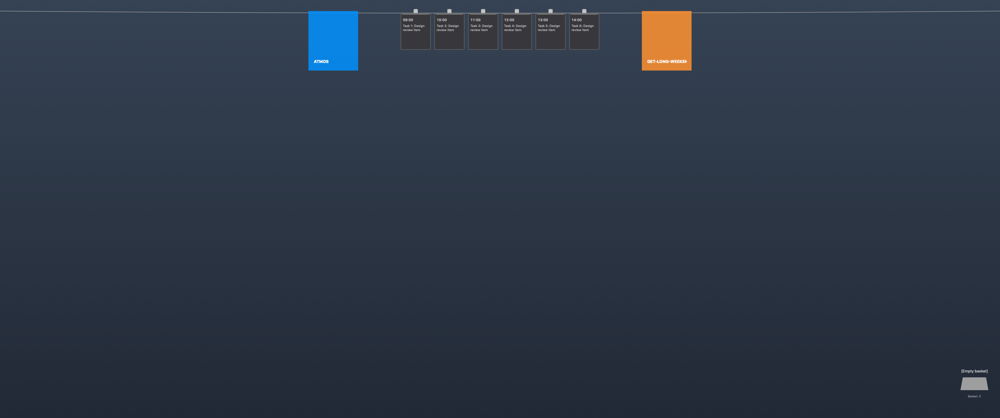
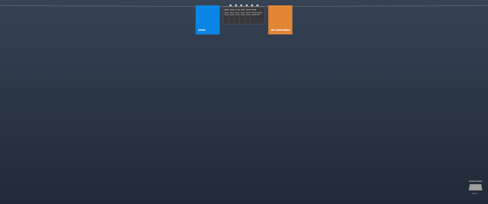
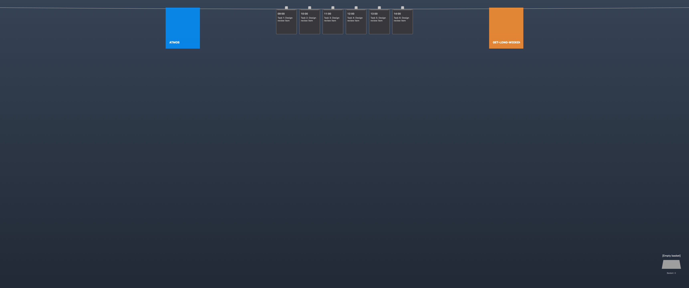
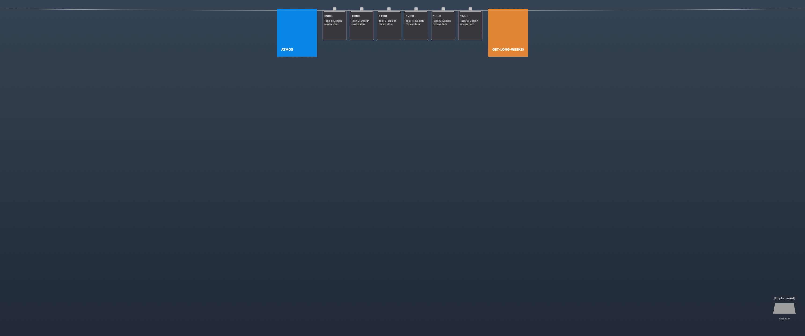
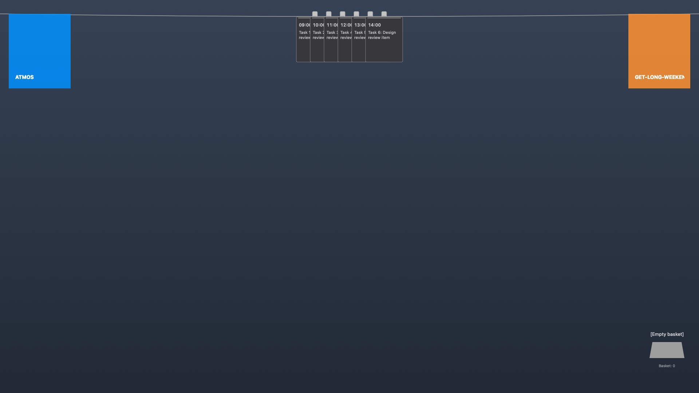
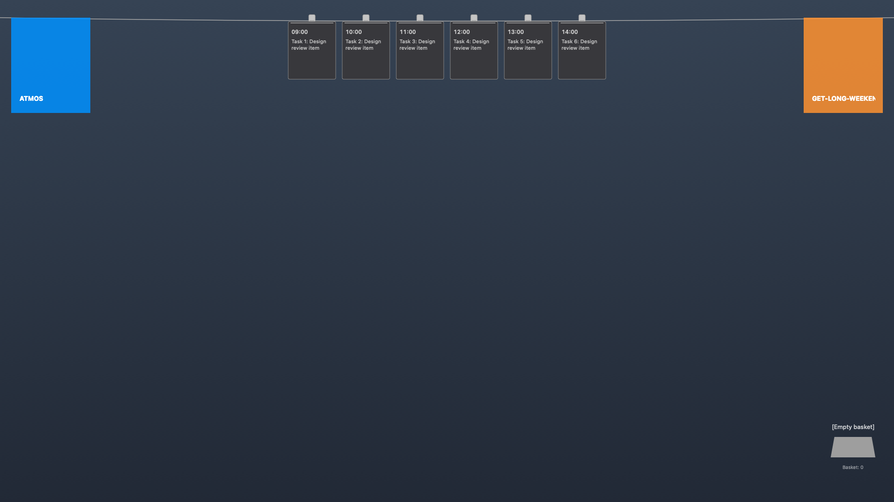

# Varal ultrawide Option B evidence

The before/after captures below were rendered offscreen from the app layout at the named display dimensions; they are not photographs of a physical display. `before` is the proportional-thirds layout from PR #2 main and `after` is Option B. At 3440×1440, both expanded captures show the same six task slips at full 116 pt pitch, centered from x=1378 to x=2062. In the before layout (Option C), the expanded cluster leaves a 380.3 pt gap to each large piece, whose centers are at W/3 and 2W/3; as the cluster expands, the pieces yield outward to x=827.7 and x=2442.3. In the after layout, the pieces sit at a fixed 24 pt gap from the cluster edges, at x=1184 and x=2086. At 1920×1080, collapsed and expanded layout coordinates are identical before and after: Atmos minX 24 pt and Get Long Weekend minX 1726 pt.

## Captures

| Display and state | Before | After |
| --- | --- | --- |
| 3440×1440, collapsed |  |  |
| 3440×1440, expanded |  |  |
| 1920×1080, collapsed |  |  |
| 1920×1080, expanded |  |  |

## Findings audit

### Already resolved in main

- **review-4:** Tearing a slip preserves its clothespin and neighboring positions; `ClotheslineCanvasView.swift` tear handling leaves slot geometry stable, covered by `tearLeavesPinWithoutShifting`.
- **review-5:** During downward drag the slip follows the pointer until the 48 pt tear threshold; `TaskSlipView.swift` drag tracking is covered by `dragPointerFollowing`.
- **review-6:** Basket undo requires an upward drag; `LaundryBasketView.swift` handles the drag gesture, covered by `basketClickDoesNothingDragUndoes`.
- **review-10:** Atmos suspends WKWebView rendering and timer updates on non-visible spaces while displaying its static snapshot; `AtmosPiece.swift` suspension path implements this behavior.
- **review-13:** English and Portuguese UI chrome strings are present in `UIStrings.swift` and used by `MenuBarController.swift`; covered by `menuBarAndSettingsStringsBilingual`.
- **review-14:** Clicking the laundry basket does not undo; `LaundryBasketView.swift` click handling is a no-op, covered by `basketClickDoesNothingDragUndoes`.

### Fixed now

- None. No valid findings remained unfixed in this audit.

### No longer applicable

- **review-12:** Rollover persistence across app quit is outside the current contract: `docs/designs/varal.md` §2.5.1 and correction C9 define rollover as in-memory while running and specify that a quit through 04:00 AM misses rollover until the next boundary while running.
